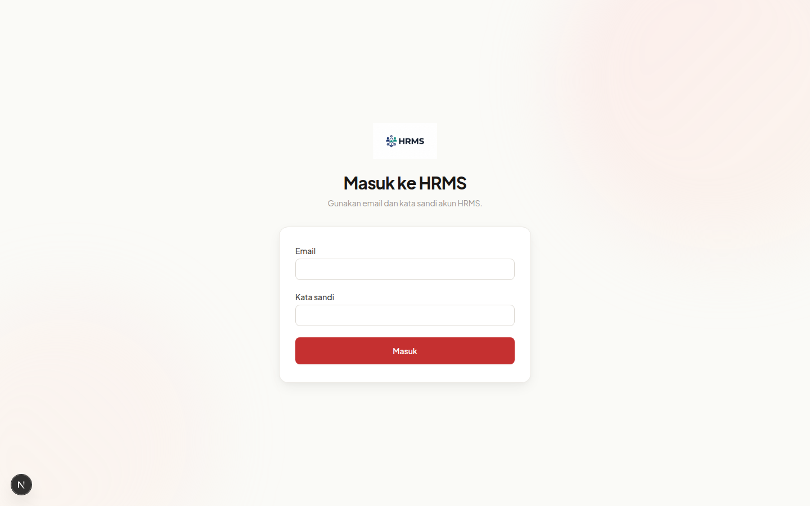
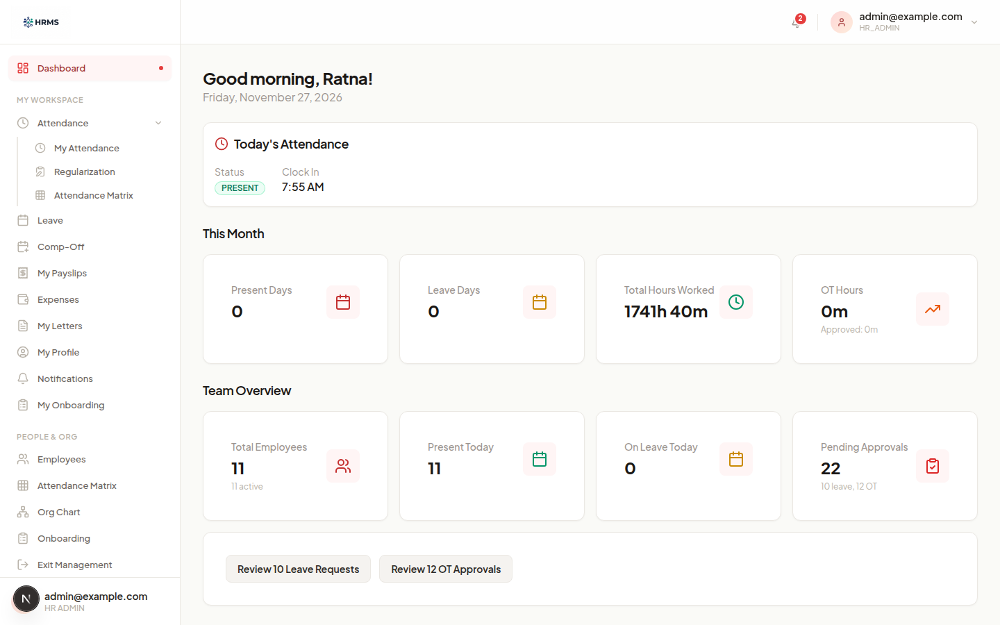
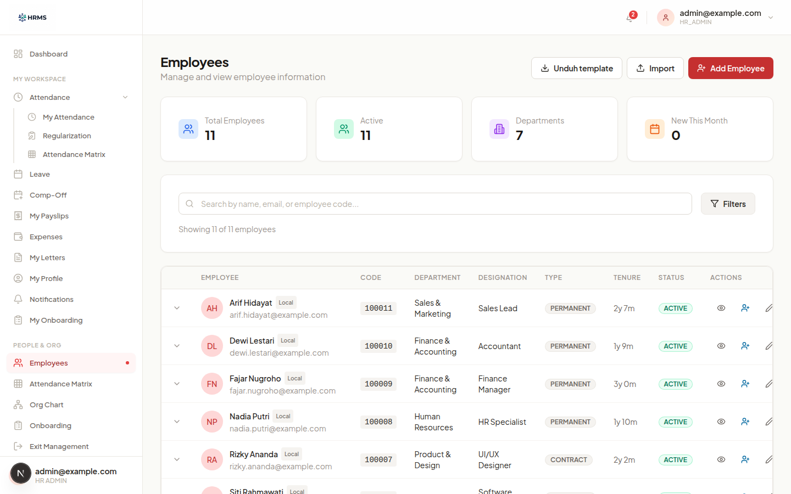
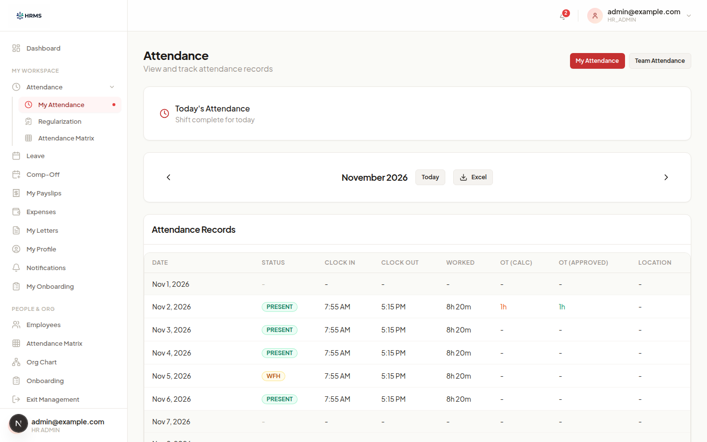
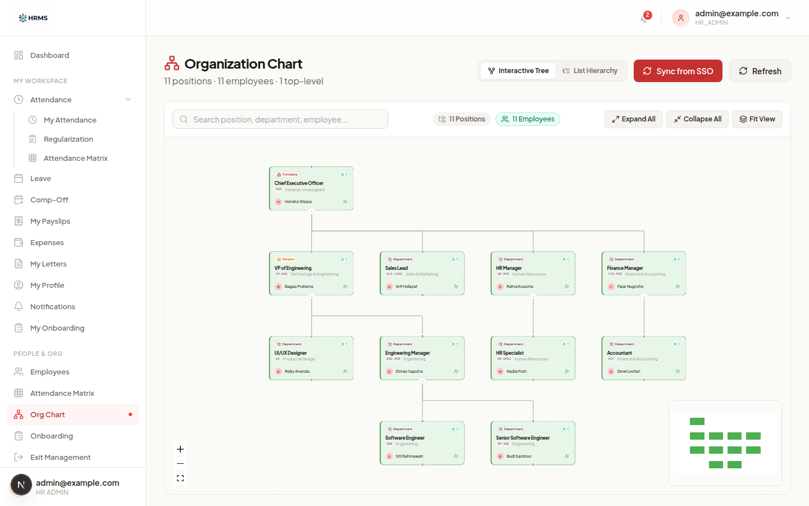
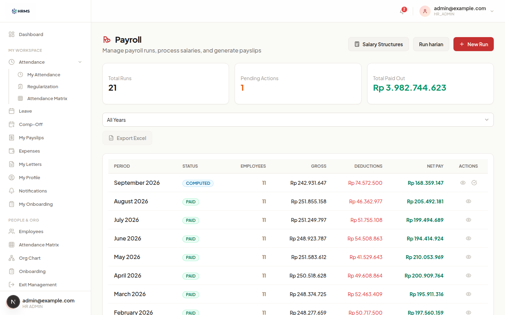
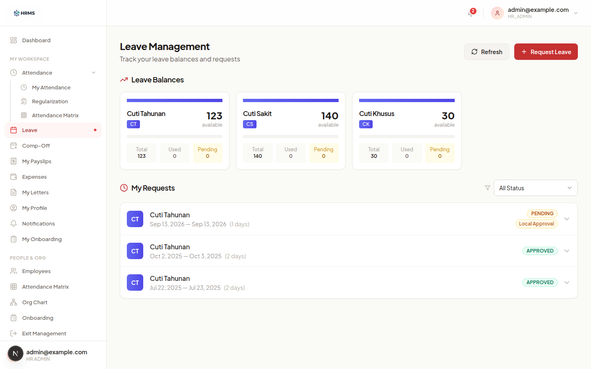
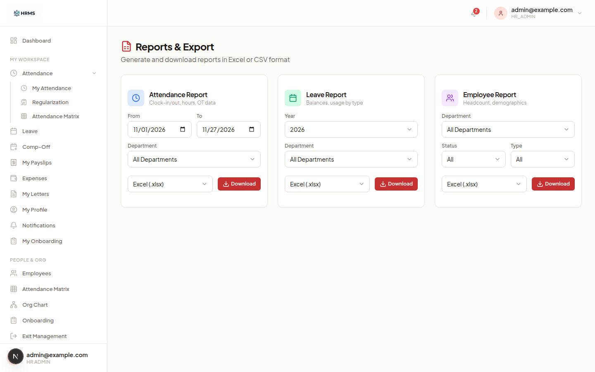

# HRMS — Human Resource Management System

## 1. Description

**HRMS** adalah aplikasi web multi-perusahaan (multi-tenant) untuk mengelola seluruh siklus hidup karyawan secara terintegrasi — mulai dari data induk karyawan, struktur organisasi, absensi, lembur, cuti, penggajian (payroll), klaim pengeluaran, penilaian kinerja, onboarding, hingga manajemen keluar kerja (exit management).

Setiap peran (`EMPLOYEE`, `MANAGER`, `HR_ADMIN`, dan `SUPER_ADMIN`) mendapatkan akses menu dan alur kerja yang sesuai. Data antar perusahaan dipisahkan per tenant secara ketat, sementara absensi dari mesin biometrik/kartu di lokasi terhubung langsung ke API absensi terpusat sehingga seluruh catatan kehadiran dan lembur bermuara ke sumber data yang sama.

## 2. Overview

HRMS menyatukan operasional SDM yang umumnya tersebar di spreadsheet, formulir manual, dan sistem terpisah menjadi satu platform terpadu. Satu catatan karyawan menjadi acuan tunggal untuk kehadiran, saldo cuti, komponen gaji, serta dokumen dan surat kepegawaian.

### Arsitektur Informasi & Peran Pengguna

Antarmuka dibagi berdasarkan alur kerja harian dan disaring otomatis berdasarkan peran:

1. **My Workspace** — Dasbor ringkasan harian, profil mandiri (self-service), absensi pribadi, koreksi absensi, pengajuan cuti & comp-off, slip gaji, klaim pengeluaran, surat karyawan, tugas onboarding, serta pusat notifikasi.
2. **Team & Approvals** — Antrean persetujuan terpusat bagi manajer untuk cuti, lembur, klaim biaya, koreksi absensi, dan evaluasi kinerja tim.
3. **People & HR Operations** — Direktori karyawan, bagan organisasi interaktif, manajemen shift, hari libur, akrual & saldo cuti, proses payroll bulanan/harian beserta generator slip gaji PDF, siklus penilaian kinerja, onboarding, exit management, dan ekspor laporan.
4. **Company & Administration** — Pengaturan multi-perusahaan, cabang, departemen, jabatan, pengumuman internal, dan jejak audit (audit trail).

### Keunggulan Teknis

- **Isolasi Multi-Tenant**: Setiap permintaan API terikat pada `tenantId` dari sesi autentikasi sehingga data karyawan, absensi, cuti, dan payroll antar perusahaan tidak pernah tercampur.
- **Alur Persetujuan Terstruktur**: Setiap pengajuan (cuti, lembur, klaim, koreksi absensi, perubahan profil) memiliki antrean dan dampak bisnis masing-masing — persetujuan cuti memperbarui saldo otomatis, sementara persetujuan lembur masuk ke perhitungan payroll.
- **Integrasi Mesin Absensi & Portal Web**: Tap dari perangkat absensi di lokasi dan clock-in/out dari portal web diproses dalam satu mesin kalkulasi harian yang memperhitungkan jadwal shift serta hari libur.

## 3. Client

Perusahaan multi-entitas, korporasi, serta tim HR, manajer, dan karyawan lintas cabang atau unit bisnis yang membutuhkan satu sistem informasi SDM terpusat.

## 4. Service

Desain, arsitektur, dan pengembangan sistem informasi SDM (HRIS/HRMS) end-to-end berbasis web — mencakup API backend modular, antarmuka portal web multi-peran, integrasi perangkat absensi, generator dokumen PDF/Excel, serta dukungan deployment kontainer.

## 5. Tech Stack

| Lapisan | Teknologi |
| --- | --- |
| Backend API | NestJS 11, TypeScript, Express |
| Basis Data & ORM | PostgreSQL 16, Prisma 6 |
| Frontend Web | Next.js 16 (App Router, Turbopack), React 19, Tailwind CSS 3 |
| Form & State | React Hook Form, Zod, Zustand |
| Visualisasi Organisasi | React Flow, Dagre |
| Grafik & Laporan | Recharts |
| Autentikasi & Keamanan | SSO / JWT, Passport, Helmet |
| Antrean Latar Belakang | BullMQ, Redis (opsional) |
| Penyimpanan Berkas | Penyimpanan Lokal / S3, Multer |
| Generator Dokumen | PDFKit, ExcelJS, Handlebars |
| Notifikasi Email | Nodemailer, Microsoft Graph Client |
| Logging & Kontrak API | Winston, Swagger / OpenAPI |
| Pengujian | Jest, Testing Library |

## 6. Features

- **Direktori Karyawan & Bagan Organisasi**: Pengelolaan data induk karyawan, impor/ekspor massal Excel, struktur departemen bersarang, jabatan, cabang, serta bagan organisasi interaktif.
- **Absensi & Matriks Kehadiran**: Clock in/out web dengan dukungan multi-sesi harian, matriks kehadiran rentang tanggal, koreksi absensi (regularization), serta API sinkronisasi mesin absensi (kartu, wajah, dan penerimaan tap).
- **Manajemen Shift, Libur & Lembur**: Penjadwalan shift per karyawan atau massal, kalender libur perusahaan/nasional, aturan lembur fleksibel, perhitungan jam dibayar, dan persetujuan manajer.
- **Cuti & Akrual**: Jenis cuti fleksibel, perhitungan akrual otomatis, kompensasi cuti (comp-off), kalender tim, serta analitik pemakaian cuti.
- **Payroll & Slip Gaji PDF**: Pengaturan struktur gaji, penempatan gaji karyawan, run payroll bulanan dan harian, alur persetujuan hingga status dibayar, serta slip gaji PDF yang dapat diunduh karyawan.
- **Klaim Pengeluaran (Expenses)**: Pengajuan reimbursement per kategori, alur persetujuan, dan pelacakan status pembayaran.
- **Penilaian Kinerja (Performance)**: Siklus penilaian berkala, ulasan diri (self-review), ulasan manajer, dan penetapan sasaran kerja.
- **Onboarding & Exit Management**: Template onboarding terstruktur, daftar tugas karyawan baru, dan manajemen proses keluar kerja.
- **Dokumen, Surat & Pengumuman**: Penerbitan surat karyawan, verifikasi dokumen dengan pengingat masa berlaku, pengumuman perusahaan, notifikasi, dan jejak audit.
- **Laporan & Ekspor Data**: Laporan absensi, cuti, dan data karyawan dalam format Excel (`.xlsx`) dan CSV.

## 7. Screenshots

Berikut 6 cuplikan layar unggulan dari aplikasi **HRMS** yang dijalankan secara lokal:

### 1. Portal Masuk (Login)
Halaman autentikasi dengan identitas **HRMS** yang bersih dan responsif.

### 2. Dasbor Utama
Ringkasan status kehadiran hari ini, metrik bulanan (hari hadir, cuti, total jam kerja, lembur), serta navigasi berbasis peran.

### 3. Direktori & Impor Karyawan
Daftar karyawan lengkap dengan ringkasan metrik, pencarian, filter departemen/status, serta fitur unduh template dan impor massal.

### 4. Absensi & Rekam Kehadiran
Pelacakan clock-in/out harian, navigasi periode bulanan, tombol ekspor Excel, serta tabel jam kerja dan lembur.

### 5. Bagan Organisasi Interaktif
Visualisasi hierarki perusahaan dalam mode pohon interaktif maupun daftar hierarki dengan sinkronisasi struktur organisasi.

### 6. Penggajian (Payroll)
Pengelolaan run payroll bulanan/harian, ringkasan total pembayaran, status persetujuan, serta pembuatan slip gaji PDF.

### 7. Manajemen Cuti (Leave Management)
Pemantauan saldo cuti (Cuti Tahunan, Cuti Sakit, Cuti Khusus) serta riwayat dan status pengajuan cuti karyawan.

### 8. Laporan & Ekspor Data
Pusat laporan absensi, cuti, dan data karyawan dalam format Excel (`.xlsx`) dan CSV.

